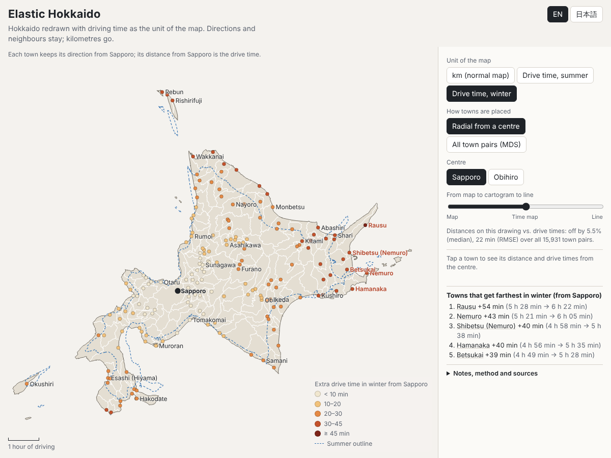
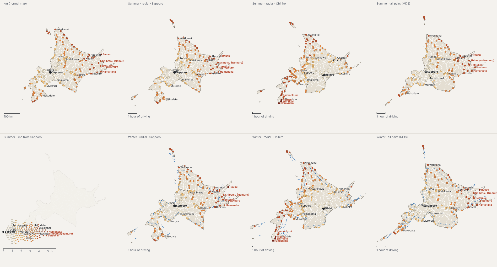

# Elastic Hokkaido

**#30DayMapChallenge 2026 · Day 25 “Is this a map?”** (posted 25 November 2026)

**Live:** https://shinyanakashima.github.io/30daymapchallenge-2026day25-elastic-hokkaido/



A normal map keeps directions and neighbours and measures everything in kilometres.
Elastic Hokkaido keeps the directions and neighbours of Hokkaido's 179 municipalities but swaps the kilometre for **car driving time**, in summer and in winter.
The island stretches where roads are slow, shrinks where they are fast, and grows in winter when passes close and speeds drop.
At the end of the slider the directions are dropped as well and the towns collapse onto a single line ordered by driving time: a chart, no longer a map.

普通の地図は、方角と隣り合う関係を保ち、km で距離を測って描かれています。
この作品では北海道179市町村の方角と隣り合う関係はそのままに、地図の単位を km から **車の移動時間（夏・冬）** に取り替えました。
道路が遅いところで北海道が伸び、速いところで縮み、冬は峠の通行止めと速度の低下で大きくなります。
スライダーを右端まで動かすと方角も捨て、町を中心からの時間の順に1本の線に並べます。どこで地図でなくなるかを見る作品です。

## What you can do / 画面でできること

- **Unit / 単位**: km (normal map) · drive time, summer · drive time, winter
- **Method / 作り方**: radial from a centre (Sapporo or Obihiro) · all town pairs (MDS)
- **Slider / スライダー**: normal map → time map → a single line
- Tap a town for its straight-line and road distance and its summer and winter drive time from the centre. Towns that get much farther in winter are coloured and labelled; the summer outline is drawn as a dashed line over the winter map.
- English by default, 日本語 with one click. The state is kept in the URL hash (`#unit=winter&method=mds&center=obihiro&lang=ja&s=1`).
- Works on phones. With “reduce motion” enabled the shape changes without animation.

## Method / 計算と変形の方法

1. **Towns** – the 179 municipalities from 国土数値情報 N03 (Sapporo's 10 wards merged; the six villages of the Northern Territories are excluded because no road reaches them). Each town is represented by its town hall from 国土数値情報 P05 (本庁, code 1). For 旭川市, 湧別町 and 新ひだか町 the main building is recorded under code 2 and is picked by name (総合庁舎, 上湧別庁舎, 静内庁舎). Boundaries are dissolved and simplified with mapshaper (topology kept, so neighbours share the same vertices). Coordinates are projected to a transverse Mercator centred on Hokkaido, in km.
2. **Drive times** – OSRM v5.27.1 runs locally in Docker (MLD, car profile) on the OpenStreetMap Hokkaido extract. A 179 × 179 table of town-hall-to-town-hall durations is requested from the local server; the public demo server is never used. The profile (`profiles/car_hokkaido.lua`) is OSRM's `car.lua` with three changes:
   - ferries without a `duration` tag run at 30 km/h (OSRM's default of 5 km/h makes Rishiri, Rebun and Okushiri 14 hours away), no waiting time;
   - winter: listed OSM ways are treated as closed;
   - winter: every road speed is multiplied by a factor.
   Times are averaged over both directions.
3. **Winter** – Winter network: 国道334号 知床横断道路 and the 道道 sections closed all day in winter, taken from the official lists of 北海道開発局 (釧路・網走開発建設部) and the ten 建設管理部 of 北海道 (84 sections; full list with sources in `data/winter_closures.csv`). Each list gives a road number and two gates; the gate coordinates in the CSV are approximate (address geocoding of the 字, or a named feature nearby). A way is closed when it carries the section's road number (`ref`) and at least half of its nodes lie within *R* of the line between the two gates (*R* = max(2.5 km, 0.25 × listed length); when both gates share one approximate point, *R* = max(3 km, 0.6 × length) around it). 80 sections matched 1373 OSM ways (1055 km blocked against 721 km listed, so some stretches are blocked a few km beyond the gates); 4 short sections (道道746号 高見西舎線, 道道741号 上遠別霧立線, 道道1049号 苫前小平線, 道道1049号 苫前小平線) found no matching way. Sections closed only at night (オロフレ峠, 白老大滝線, 朝里峠, 知床公園線 岩尾別) are kept open. The 帯広 and 函館 lists for 2026–27 had not been published when the data was collected, so the 2025–26 lists are used for those two areas.
   Winter speeds (`data/winter_speed.json`): motorway, trunk, primary and secondary roads × 0.88; all other roads × 0.80. 0.88 is the factor for snow/ice-covered roads in good visibility used by 北の道ナビ's winter travel-time calculator (土木研究所報告 第220号, 2014, 表-5.9). 0.80 follows the autumn-to-winter drop in travel speed on Sapporo's national roads in the 2005 road traffic census (−15 to −20%, 北海道開発局 2010). Assigning the first value to inter-town road classes and the second to the rest is an assumption of this work. Blizzards, poor visibility and temporary closures are not modelled.
4. **Scale** – one scale *k* (km on the drawing per hour of driving) is fitted by least squares between straight-line distances and summer drive times over all town pairs, and used for every layout, so the winter map can grow relative to the summer one. *k* = 54.2 km/h.
5. **Radial layout (中心型)** – each town keeps its bearing from the centre (Sapporo or Obihiro city hall) and its distance from the centre becomes *k* × drive time.
6. **All-pairs layout (全点型)** – metric MDS (classical MDS as the start, refined with SMACOF, scikit-learn) on *k* × drive time for all pairs, then an orthogonal Procrustes fit (rotation, reflection allowed, translation; scale fixed at *k*) to the normal map.
7. **Warping the map (補間)** – the displacement of the 179 town halls is interpolated over the plane with a **thin-plate spline** (`scipy.interpolate.RBFInterpolator`, kernel `thin_plate_spline`, smoothing 0, so it passes exactly through every town hall) and applied to every boundary and coastline vertex. Only the town-hall positions come from the travel times; everything in between is a choice of interpolation.
8. **Line (1本の線)** – the last stage of the slider places each town at *k* × drive time from the centre on a horizontal line (the same scale as the map), with a small vertical offset only to keep dots from overlapping.

## Results / 結果



Fit between distances on each drawing and drive times, over all 15,931 town pairs (median of the relative error, RMSE and MAE in minutes, Kruskal stress-1). “Folded municipalities” counts municipalities whose warped boundary crosses itself.

| Layout | Unit | Centre | Median error | RMSE (min) | MAE (min) | Stress-1 | Folded municipalities |
|---|---|---|---|---|---|---|---|
| Normal map (km) | summer | – | 8.9% | 29 | 20 | 0.129 | 0 |
| Normal map (km) | winter | – | 9.8% | 40 | 26 | 0.178 | 0 |
| Radial | summer | sapporo | 5.3% | 19 | 13 | 0.088 | 5 |
| Radial | summer | obihiro | 5.5% | 18 | 13 | 0.081 | 13 |
| All pairs (MDS) | summer | – | 3.3% | 11 | 8 | 0.048 | 8 |
| Radial | winter | sapporo | 5.5% | 22 | 15 | 0.091 | 5 |
| Radial | winter | obihiro | 5.6% | 20 | 15 | 0.082 | 13 |
| All pairs (MDS) | winter | – | 3.3% | 12 | 9 | 0.049 | 7 |

- The normal map already predicts summer drive times within about 9% (median); the radial layouts halve the error and the all-pairs layout brings it to about 3%.
- Seen from Sapporo or Obihiro, winter is close to a uniform slowdown: the drive time to 90% of towns grows by 12.5–14.5%, so the winter map is mostly a slightly larger copy of the summer one. The largest extra time from Sapporo is Rausu (+54 min, 5 h 28 min → 6 h 22 min), then Nemuro (+43 min); from Obihiro it is Matsumae and Fukushima (+49 min).
- The closures act on neighbours rather than on the whole island: Wassamu–Horokanai ×2.07 (27 → 56 min), Shari–Rausu ×1.63 (51 → 83 min), Kiyosato–Rausu ×1.56, Tsubetsu–Kunneppu ×1.53, Mikasa–Furano ×1.51. Only the all-pairs layout can show these; the radial layout keeps them hidden behind the centre's view.

結果のまとめ：普通の地図でも夏の移動時間との差は中央値で約9%。中心型で約5%、全点型で約3%まで小さくなる。中心から見ると冬はほぼ一様に13%前後（9割の町で12.5〜14.5%）遠くなり、通行止めの影響は隣り合う町どうしの組に現れる（和寒–幌加内 2.07倍、斜里–羅臼 1.63倍など）。

## Notes / 注記

- Drive times are computed with OSRM on OpenStreetMap road data. Congestion, weather and waiting at signals are not considered. / 時間は OpenStreetMap の道路データと OSRM による計算で、渋滞や天候は考慮していません。
- NOTES_Winter network: 国道334号 知床横断道路 and the 道道 sections closed all day in winter, taken from the official lists of 北海道開発局 (釧路・網走開発建設部) and the ten 建設管理部 of 北海道 (84 sections; full list with sources in `data/winter_closures.csv`). Each list gives a road number and two gates; the gate coordinates in the CSV are approximate (address geocoding of the 字, or a named feature nearby). A way is closed when it carries the section's road number (`ref`) and at least half of its nodes lie within *R* of the line between the two gates (*R* = max(2.5 km, 0.25 × listed length); when both gates share one approximate point, *R* = max(3 km, 0.6 × length) around it). 80 sections matched 1373 OSM ways (1055 km blocked against 721 km listed, so some stretches are blocked a few km beyond the gates); 4 short sections (道道746号 高見西舎線, 道道741号 上遠別霧立線, 道道1049号 苫前小平線, 道道1049号 苫前小平線) found no matching way. Sections closed only at night (オロフレ峠, 白老大滝線, 朝里峠, 知床公園線 岩尾別) are kept open. The 帯広 and 函館 lists for 2026–27 had not been published when the data was collected, so the 2025–26 lists are used for those two areas.
   Winter speeds (`data/winter_speed.json`): motorway, trunk, primary and secondary roads × 0.88; all other roads × 0.80. 0.88 is the factor for snow/ice-covered roads in good visibility used by 北の道ナビ's winter travel-time calculator (土木研究所報告 第220号, 2014, 表-5.9). 0.80 follows the autumn-to-winter drop in travel speed on Sapporo's national roads in the 2005 road traffic census (−15 to −20%, 北海道開発局 2010). Assigning the first value to inter-town road classes and the second to the rest is an assumption of this work. Blizzards, poor visibility and temporary closures are not modelled.
- The warp is an interpolation: only the town positions are fixed by data, the other shapes change with the method. / 変形は補間によるもので、町の位置以外の形は方法によって変わります。

## Data sources / データの出典

| Data | Source | Retrieved |
|---|---|---|
| Municipal boundaries and coastline | 国土数値情報（行政区域データ）N03, 2026-01-01 版, 北海道 (`N03-20260101_01_GML.zip`) – 出典：国土数値情報（行政区域データ）を加工して作成 | 2026-11-08 |
| Town halls | 国土数値情報（市町村役場等及び公的集会施設データ）P05, 2022 版, 北海道 (`P05-22_01_GML.zip`) – 出典：国土数値情報（市町村役場等及び公的集会施設データ）を加工して作成 | 2026-11-08 |
| Roads | OpenStreetMap, Hokkaido extract (data as of 2026-11-07 00:12 UTC), © OpenStreetMap contributors, ODbL. Geofabrik's `hokkaido-latest.osm.pbf` was not reachable from the build environment, so the same-scope extract from download.openstreetmap.fr (`extracts/asia/japan/hokkaido-latest.osm.pbf`) was used. | 2026-11-08 |
| Routing | OSRM v5.27.1 (`ghcr.io/project-osrm/osrm-backend:v5.27.1`) | 2026-11-08 |
| English names | OpenStreetMap `name:en` of the municipal boundaries | 2026-11-08 |
| Winter closures (国道) | 釧路開発建設部・網走開発建設部 記者発表「国道334号 知床横断道路 冬期の通行規制」(2025-10-17) https://www.hkd.mlit.go.jp/ks/release/d1uled0000000c60-att/pranac00000004vc.pdf | 2026-11-08 |
| Winter closures (道道) | 北海道 稚内・釧路・網走・室蘭・旭川・小樽・札幌・留萌建設管理部 令和8年度 冬期通行止区間一覧; 帯広・函館建設管理部 令和7年度 一覧 (each URL and date per section in `data/winter_closures.csv`) | 2026-11-08 |
| Winter speed | 土木研究所報告 第220号「冬期道路の安全性・効率性向上に関する研究」(2014) https://thesis.pwri.go.jp/files/doken_houkoku_0220_01.pdf ; 北海道開発局「資料２ 北海道地方の課題と道路における取組について」(2010-12-14) https://www.hkd.mlit.go.jp/ky/kn/dou_kei/splaat0000016fjv-att/splaat0000016fqh.pdf | 2026-11-08 |

## Reproduce / 再現手順

Requirements: Docker, Python 3.11+, Node.js 18+.

```sh
pip install geopandas shapely pyproj scipy scikit-learn requests osmium pandas
npm install -g mapshaper
scripts/download.sh                       # N03, P05, OSM extract → build/raw
cd scripts
python 01_municipalities.py               # polygons + town halls
python 02_names_en.py                     # English names from OSM
python 05_profile_params.py summer && ./osrm_build.sh summer
python 03_matrix.py summer                # 179 × 179 summer matrix (local OSRM)
python 04_winter_closures.py              # closed sections → OSM way ids
python 05_profile_params.py winter && ./osrm_build.sh winter
python 03_matrix.py winter
python 04_layout.py                       # layouts + accuracy
python 06_warp.py                         # thin-plate spline warp → web/data/elastic.json
python 07_notes.py                        # on-screen notes
cd ..
python -m http.server -d web 8123         # open http://127.0.0.1:8123/
node tests/check_page.cjs                 # Playwright check + docs/screenshot.png
node tests/compare.cjs                    # docs/compare.png
```

The site in `web/` is deployed to GitHub Pages by `.github/workflows/pages.yml`.

## License

Code: MIT (see LICENSE). Data: © OpenStreetMap contributors (ODbL); 国土数値情報 (国土交通省); see the sources above.
